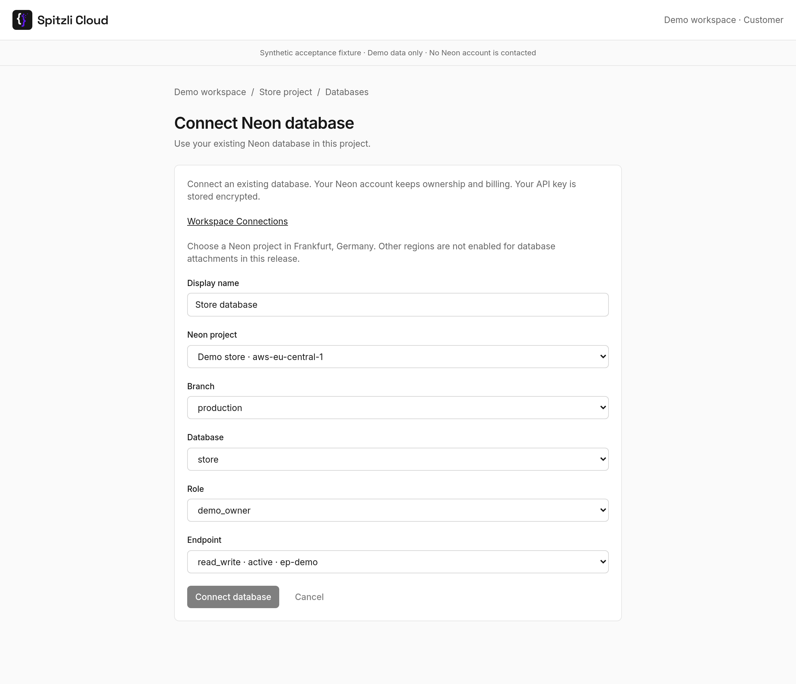
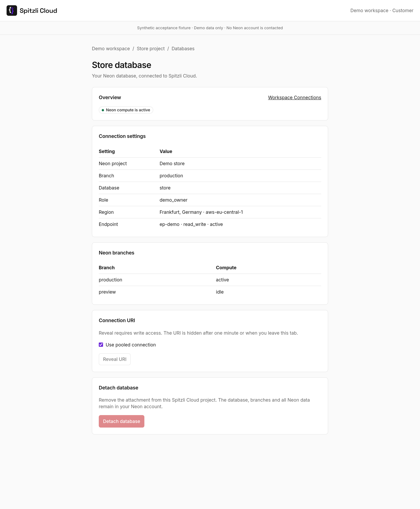
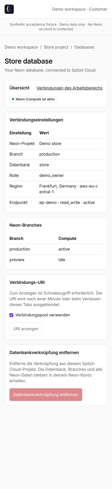

# Neon for Spitzli Cloud

Connect an existing Neon database to a Spitzli Cloud project, browse its branches and
reveal its connection URI when needed. This independent native v2 plugin is
maintained by Spitzli. It does not create compute, projects, databases or branches,
run SQL, or delete anything in Neon.

## Connect a database

1. Open **Workspace Connections** in Spitzli Cloud and connect a Neon API key. Existing
   optional CLI instructions in Connections remain available. Workspace owners,
   administrators and authorized operators manage this connection.
2. Your operator installs the reviewed plugin and enables **Connect Neon databases** for your workspace. Your plan must permit another database attachment.
3. Open **Neon → Connect database**. Give the attachment a display name, then
   select a Neon project, branch, database, role and compute endpoint. Projects
   include their provider region so you can verify your placement choice.
4. Open the attachment to inspect its nonsecret settings and branch inventory.
   **Reveal URI** requires write access. Pooled connections are selected by
   default; choose a direct connection for migrations and tools that need it.
5. **Detach database** removes this project's attachment. Your database, compute,
   branches and data remain in your Neon account. The workspace connection stays
   available for other attachments.

The selection uses the projects authorized by the workspace's existing key.
No key or opaque provider identifier needs to be pasted into a plugin form.
An idle endpoint can appear in the inventory; observing it does not wake compute.
Provider access errors are deliberately generic to keep credentials out of errors.

## Security and ownership

Core stores the encrypted provider key, connection identity/revision, protected
attachment tuple and immutable nonsecret idempotency receipts in its existing
PostgreSQL database. The plugin is stateless: no metadata database, API key,
provider origin or secret-bearing configuration is accepted. Core scopes every
callback to the persisted admission, customer, project, action and current browser
authority, and validates that authority before and after provider IO.

The callback uses the published, unchanged
`HostClient.call(token, "http", "request", request)` ABI with binding `neon`.
The manifest declares `httpBindings: ["neon"]` for provider callbacks. Actions
do not set `httpBinding`, which requests a separate website/SSO authority adapter.
Inventory GETs use `plugin.http.read`. Attach, URI reveal and detach POSTs use
`plugin.http.request` and their exact write action. API-token invocation, jobs and MCP access are not
supported in this release. Core derives resource identity and provider tuples;
caller input cannot replace them. Attach and detach forward the original admitted
input unchanged and replay Core's public receipts when a response is lost.

Inventory and panels project only safe fields. Passwords, API keys and URI values
are excluded. URI reveal returns only `{value:string}` through the dedicated
write action. The Console uses `usePluginReveal`, keeps the value outside shared
query/mutation caches, clears it on scope changes/unmount, and hides it after one
minute or when the tab becomes hidden. Copying explicitly writes it to your
clipboard; Spitzli Cloud does not control the clipboard's retention. Core must send
`Cache-Control: no-store` for this action. Browser memory and the authenticated
native response necessarily hold the URI while it is being revealed.

## Native actions

| Action | Access | Result |
| --- | --- | --- |
| `databases.discover` | read, customer, `connect-databases` | Safe paginated selectors for existing resources |
| `databases.attach` | write/create, `database`, `connect-databases` | Core-owned `{resource:{id,name}}` |
| `databases.view` | read/use | Native v2 status/settings panel |
| `databases.branches` | read/use | Native v2 read-only branch table |
| `databases.credentials` | write/use | Ephemeral `{value:uri}`; `pooled` defaults to true |
| `databases.detach` | write/delete | Nonsecret detach receipt; no provider DELETE |

`manifest.json` is the reviewed authoring contract. The zero image digest is an
authoring placeholder and cannot be released. Finalization requires the actual
pushed immutable digest and creates identical native release descriptor bytes.

## Build and integration

See [STANDALONE.md](STANDALONE.md) for the exact SDK/toolchain, qualified build
commands, host UI ABI check and release procedure. The Console bundles
[ui/index.tsx](ui/index.tsx) through `@webdock/plugin-ui`; it is a host peer module,
not a separately authenticated website. Native panels remain usable when the
custom module is unavailable. The custom Create module is required for selector
based attachment instead of the generic opaque-ID form.

## Screenshots

These are the actual Console components using synthetic fixture data and disabled
write actions. No Neon account is contacted and no credential is revealed.

See [capture instructions and provenance](screenshots/README.md). These screens
do not establish a live provider connection or an enabled production installation.

## Later Neon capabilities

Auth, Object Storage, Realtime, Functions and AI Gateway are potential future
work. They are not supported actions, entitlements or installed services in this
release. Database provisioning and branch changes would need separate product,
authorization and billing decisions.

Neon branding comes from the [official brand assets](https://neon.com/brand).
The plugin is not endorsed by Neon. Source code is AGPL-3.0-only; see LICENSE,
NOTICE and COMMERCIAL-LICENSING.md for exceptions and artwork ownership.

## Initial database region

New database attachments require an existing project in AWS Frankfurt (`aws-eu-central-1`). Core checks the actual provider project metadata, not a form label. Inventory can show other projects, but they cannot be attached in this release. This preserves the platform's EU placement policy; the initial supported database region is deliberately explicit. No existing project is moved or deleted. See [Neon regions](https://neon.com/docs/introduction/regions).

Workspace owners, administrators and authorized operators browse provider-wide project and branch inventory. Read-only customer preview may view permitted settings, but cannot enumerate the provider account or reveal a URI. Ordinary workspace membership alone does not grant Neon actions; the existing database-management permission remains required. Disabling new attachments does not disable an owner's local detach cleanup.
